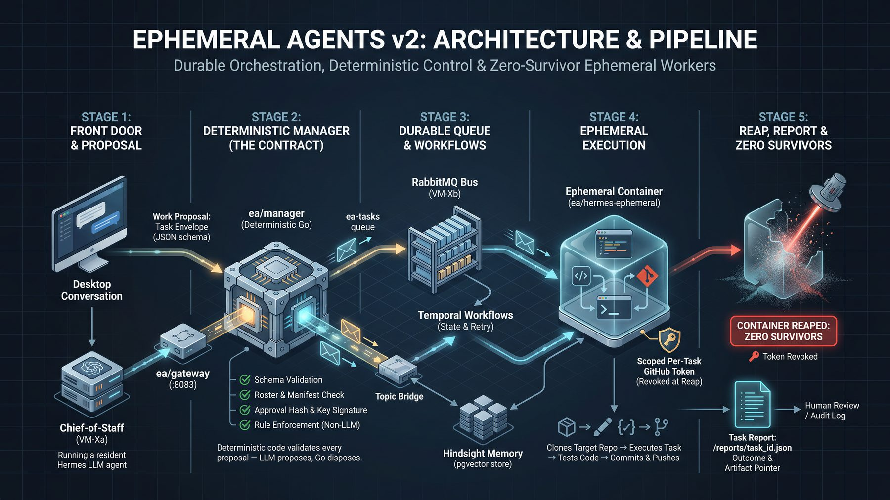

# The Ephemeral Agents Book — Version 2

*The `ea-` build: an organization of AI agents, rebuilt to coexist.*

This is the closing deliverable of the V2 build, per the owner's
decision of 2026-11-10: the book is written after the full
installation/deployment is proven working — it contains V2's findings
and the corrective actions taken during the build, from the record.

It is written for two audiences at once: every chapter
opens with an **In plain terms** box; a reader who needs only the essence
reads the boxes and the headings. The running example is the V2
acceptance request — *"add a health endpoint to the POC project"* —
carried from the gateway through the queue to the coder's commit
(`7c9a32c` on the task branch).

*The pipeline at a glance — the five stages this book walks through, from
desktop conversation to zero-survivor reap.*

**What V2 is:** the same organization — three departments, durable core,
ephemeral workforce — rebuilt so that it can live *beside* another copy
of itself. The `ea-` build proved coexistence on one estate, and the
fifteen lessons of the first build were pre-applied where the design said they should be
and earned new siblings where the build found they weren't enough.

## Part I — The Thesis

| Chapter | Title | What changes in V2 |
|---|---|---|
| 1 | The Problem | stated as this book's own opening; no external reading required |
| 2 | The Thesis | the six principles stated in full; this build adds coexistence as a testable prediction |
| 3 | The Organization | the full structure; this build runs *two* organizations on one estate |

## Part II — The Practical Design, as built

| Chapter | Title | V2 emphasis |
|---|---|---|
| 4 | The Work Order | the message-v1 envelope is additive-only; the priority field landed with M1 (OQ4); queue-direct publishing (D-routing) |
| 5 | The Durable Core | `ea-net` compose-declared; single `x-max-priority` declaration point |
| 6 | The Roster | agent-roster as the one catalog (D-catalog-realization) |
| 7 | The Executors | the executor *switch*: stub → hermes → coder is a per-milestone responsibility (M5 §2') |
| 8 | Credentials | per-run App tokens; revoke-before-assert (propagation-aware) |
| 9 | Memory | git-repo llm-wiki (D-wiki-git); pointer-store convention |
| 10 | The Front Door | gateway on 8083 beside the first organization's 8080; the CoS milestone (TP-V2-M1) |
| 11 | Two Organizations, One Estate | **new V2 chapter** — coexistence rules: compose names, volumes, ports, the shared-exchange race and its fix |
| 12 | The Failure Ledger | 13 entries, each as symptom → wrong assumption → root cause → rule |
| 13 | What Remains | deferred topics and the next-version list |
| 14 | Building from Scratch | the operator's chapter: RUNBOOK-V2-BUILD, clean-VM netplan, secrets staging |
| 15 | Evaluating the System | the evaluator's chapter: gate-by-gate checklists and the live dashboards |
| 16 | After the Build: Estates That Clone | the three-layer template scheme (golden base / built template / live estate), the freeze procedure, the ~15-minute project spin-up, and the project-retirement procedure — the seven places a finished project leaves state and the two exit paths that hand the estate to the next one (ADR-0002) |

## Part III — Plain-language specials (owner directive)

The owner asked that the work-board and approval areas get special
plain-language treatment. Three self-contained pieces sit between the
parts:

- **Who is allowed to start work?** — desk, never the door: why the
  board, the queue, and the tracker are three different truths
  (D12-rev / ADR-0001).
- **What does "approved" mean?** — the approval flow from desktop to
  queue, the hash pinning, and why the report event, not the worker,
  closes the card.
- **Connecting your Desktop to a project** — the one-time wiring: what
  the gateway connection is, the seven desktop steps, the session
  token as the Desktop's only credential, and the three failure modes
  when the test fails.
- **Driving the install from your Desktop** — the agent-executed build:
  when to use the install skill, where it runs from (never a remote
  session), the setup, what a build day looks like, and what the agent
  will never do.

## Conventions

- Labels: Walls 1–7 and Principles P1–P6 are defined in Chapters 1–2 of
  this book; build findings are cited by ledger number (1–13).
- Sensitive data: none — placeholders only; concrete values live in the
  gitignored env files.
- Evidence: every measured claim traces to `deploy-v2/mN/evidence/` or
  the findings report (`V2-findings-report.md`).

*Status: structure committed; chapters drafted against the record.
The owner draws the topology diagrams that anchor Chapters 11 and 14.*
